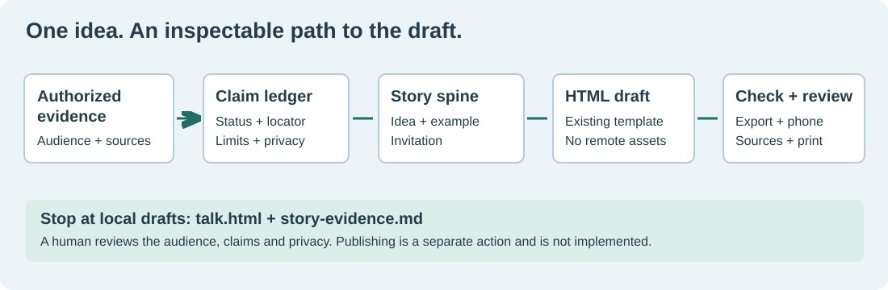

# Idea Talks

Turn authorized evidence into one idea, one concrete example and one invitation in a self-contained HTML talk. The method and standalone HTML editor/exporter are newly authored and MIT licensed. They do not publish, configure a provider or install dependencies.



## Setup

For direct use, read the canonical `skills/idea-talks/SKILL.md` and keep its resource folder together. No other capability is required. The shared installer below is optional for receipt-backed host discovery.

Use the already reviewed shared capability installer from the portfolio; no installer copy is bundled here. Substitute its path, a full 40-character commit and a chosen project destination. Preview is read-only; inspect its permissions, files and plan hash before applying.

```sh
python3 /path/to/shared/capability.py describe --manifest capability.json --source .
python3 /path/to/shared/capability.py preview --manifest capability.json --source . --revision FULL_COMMIT --dest /chosen/project --harness codex
python3 /path/to/shared/capability.py install --manifest capability.json --source . --revision FULL_COMMIT --dest /chosen/project --harness codex --apply --expect-plan REVIEWED_PLAN_HASH
```

Other supported discovery layouts: Claude Code, Gemini, Grok, OpenCode and Amplifier use the same portable method payload, with their host-specific destination selected by the shared installer. Copy/discovery is not proof that a host follows the method. `doctor`, `uninstall` and `rollback` remain shared installer operations; retain the transaction receipt. No active user installation is replaced.

## Use

Ask your agent to use Idea Talks with the idea, audience, chosen speaker words, authorized source packet and a new output path. It writes `talk.html` and `story-evidence.md`. A sample fictional repair-club draft is in `evals/dev/`. Shared Research/Long Read/Taste methods can provide optional evidence or review; they are not required package dependencies.

The browser template supports navigation, notes, overview, editing and HTML download. Downloads include notes and source details; review privacy before sharing. Browser drafts are local to that browser. No-JavaScript and print CSS retain readable slides. See [authoring](skills/idea-talks/references/authoring.md) and [the benchmark](docs/BENCHMARK.md) for measured boundaries.

## Verification boundaries

This release uses new method prose and an original replacement HTML/CSS/JavaScript implementation; the prior adapted template and artwork are excluded. See the [MIT license](LICENSE) and [release provenance](PROVENANCE.md). It is a skill at rung 2, not an autonomous author or publisher: [placement](docs/RIGHT-SHAPE.md). Audience understanding, comparative L1 quality and outside-user outcomes are not measured.

## Coordinated guide

The coordinated main-site guide is `https://michaeljabbour.github.io/capabilities/idea-talks/` (setup anchor: `#setup`). The repository owner coordinates that guide with publication. The instructions and workflow above remain self-contained. No separate Pages site is promised.

The [replacement browser software checks](docs/verification/template-browser.json) are bound to the new artifact hashes. Historical private-prototype measurements are not evidence for this implementation. Fullscreen and import are not implemented.
